<p align="center">
  
</p>

<!-- AirFrameXR overview: editorial refresh -->
# AirFrameXR

[原项目](https://github.com/jfbobier/AirFrameXR) | [中文启动器](tools/localizer/README.md) | [简体中文](README.zh-CN.md) | [English](README.md)

**为追求高性能与简洁体验的玩家打造的无线 PCVR。针对 NVIDIA 重新设计。无需 SteamVR。可选集成式帧生成。**

<p align="center">
  <a href="https://youtu.be/8F8zQXMi9BA"></a><br>
  <sub>观看 2 分钟概览（YouTube）。旁白为合成语音；图表使用维护者的实测数据。</sub>
</p>

**有疑问、配置文件或测试报告？欢迎加入 [AirFrameXR Discord](https://discord.gg/T2jQep5h6)。**

AirFrameXR 用一套**轻量、针对 NVIDIA 优化的 OpenXR 运行时与串流管线**取代了 **SteamVR + 传统 ALVR PC 串流器**。帧节奏控制、可选帧生成、NVENC 编码和无线传输由同一套管线协同处理，而不是层层叠加在 SteamVR 之上。

**头显端保持不变**：AirFrameXR 使用 **ALVR v20 协议**，因此可以继续使用现有的 ALVR 头显客户端。Windows 串流器仅支持 NVIDIA；已在 **Apple Vision Pro** 和 **Meta Quest 3** 上测试。其他兼容 ALVR 协议的客户端可能可用，但尚未在此验证。

Quest 另有专用的 **AirFrameXR Quest 客户端**（[发布版本](https://github.com/jfbobier/airframexr-metaquest)，版本 1.3.0）：它是 ALVR 20.14.1 的 Vulkan 分支，带有欢迎面板和地面高度偏移。**仅支持控制器，不支持捏合手势输入**（该功能不可靠，已移除，Vision Pro 客户端也一样）。仅在 Quest 3 上测试过；Meta 商店版 ALVR 客户端仍可正常使用。

<p align="center">
  
</p>

### 一眼看懂差异

| | 传统 PC 端 ALVR 方案 | AirFrameXR |
|---|---|---|
| 运行时 | SteamVR 运行时和合成器 | 基于 VirtualDesktop-OpenXR (VDXR) 并搭配 OVRShim 的专用 OpenXR 运行时 |
| 串流 | 独立的 ALVR PC 串流器 | 集成式串流管线，使用 ALVR 服务器组件和 v20 协议 |
| 编码 | 通用 ALVR 配置 | NVIDIA 专用 NVENC HEVC 10 位编码路径 |
| 帧生成 | 需要另行配置 | 可选，内置于帧管线：在自研轻量 CUDA 引擎上运行的神经插帧网络（RIFE），并以 NVIDIA Optical Flow 和边缘感知合成为后备方案 |
| 头显 | ALVR 客户端 | **同一个 ALVR 客户端——无需定制头显应用** |
| 兼容性优先级 | 广泛兼容 SteamVR 生态 | 轻量、OpenXR 优先；**仅支持 OpenVR 的游戏通过内置的 [OpenComposite](#openvr-only-games-opencomposite) 转译层运行**（在启动器中切换一次即可），其他游戏需要 SteamVR |

### 为什么这样设计？

AirFrameXR 面向使用无线头显和 NVIDIA GPU、希望游戏运行更快又不想面对一大堆设置的玩家。

- **更轻量的引擎**。游戏直接使用快速、轻量的 OpenXR 运行时 [VDXR](https://github.com/mbucchia/VirtualDesktop-OpenXR)，而不是 SteamVR 运行时和合成器。
- **一个运行时，尽量减少拷贝**。合成、帧节奏控制和编码在同一条管线中运行，帧通过共享 GPU 内存传递，程序之间无需额外拷贝。
- **成熟的网络层。**[ALVR](https://github.com/alvr-org/ALVR) 提供经过大型社区打磨的网络、编码和解码功能，头显端只需安装 ALVR 应用。已测试的头显为 **Meta Quest** 和 **Apple Vision Pro**。
- **专为 NVIDIA 打造**。采用 NVENC HEVC 10 位编码和**分片编码**，利用 GPU 上的所有 NVENC 单元，而非只用一个（RTX 5090 有三个），并针对帧节奏和网络进行调优。
- **游戏只渲染你看得到的内容**。所有头显都可选择使用厂商视野（Apple、Meta；默认选项），或限制为告知游戏的一个矩形视野。*AVP 优化视野*是根据 Vision Pro 实测的窗口，始终会列出；你也可以戴上头显，用约一分钟校准自己的视野（每次一只眼睛，对准四条亮线）。游戏渲染更少，运行就更快；节省下来的资源可用于提升画质。参见[视野限制的工作原理](#how-fov-restriction-works)。
- **管线内帧生成**。可选的神经网络帧生成使用 [RIFE](https://github.com/hzwer/Practical-RIFE) 网络分析连续两帧之间画面各部分的运动，由串流器以完整分辨率补出中间帧（移动物体的重影更少，静止内容保持精确）。它运行于随 AirFrameXR 一同发布的自研轻量 CUDA 引擎（11 MB；不需要 TensorRT 或 Python）。GPU 光流搭配边缘感知合成作为后备方案（边缘技术源自 [VectorXR](https://github.com/DienerTech/vectorxr)，已重新实现）。当游戏无法稳定达到头显刷新率时，它可以改善显示流畅度。此功能仍属实验性质，默认关闭，**可能增加插帧延迟**；它不是免费的 FPS 提升。
- **按游戏测量**。游戏统计会记录每款游戏的 FPS、延迟、网络和 GPU 数据。
- **减少猜测**。设置向导会读取头显支持的能力，提供社区配置文件（可分享为 JSON 文件），并在你的电脑和网络上测试结果。
- **原生 Windows 工具**。提供统一启动器，以及串流器、统计、诊断和设置等原生窗口；还可选配在头显内使用的桌面镜像。
- **保持简洁**。采用便携式分发、易读的设置和针对性工具，不试图成为通用 SteamVR 替代品。

<p align="center">
  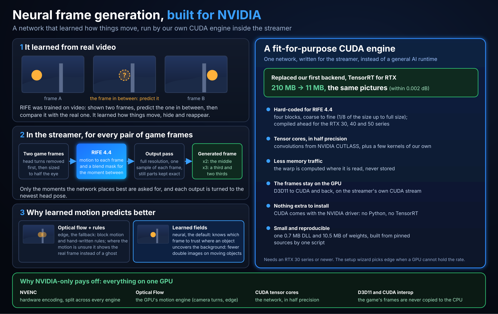
</p>

### 性能：用测量说话，不作空头承诺

**维护者对新管线的测试中，相比早期的 SteamVR + ALVR 方案，部分游戏观察到最高约 10–20% 的 FPS 提升和约 20 ms 的延迟降低**；用户也报告了相近的数据（例如 Enshrouded：维护者这里约 45 FPS，而一位用户自行测得 SteamVR 下为 35–40 FPS）。这些只是已测配置下的观察结果，**不保证一定获得提升**：表现会因游戏、头显和网络而异，某些配置下两种方案表现相当。帧生成应单独评估：它在部分 GPU 瓶颈场景中能改善输出/显示帧节奏，但也有自身的延迟取舍。技术背景请参阅下文的性能发现和测试平台。

<!-- End AirFrameXR overview -->

> [!WARNING]
> **风险自负，请谨慎测试。**
> 目前仅由一小组测试者在真实头显上测试过（维护者自己的电脑、RTX 5090、Vision Pro 和 Quest 3，包含帧生成；另在笔记本 GPU 上执行过自动化测试）。游戏可能崩溃、无法启动或显示异常画面；串流也可能卡顿或延迟过高。程序会更改电脑的 OpenXR 运行时注册，并添加一条防火墙规则
> （可通过启动器中的 OpenXR 运行时按钮“切回原设置”还原）。请注意佩戴舒适度：头显中的画面冻结或抖动可能造成不适；如有异常，请摘下头显。本程序按“现状”提供，不附带任何形式的担保（参见 [LICENSE](LICENSE)）。

**主要目标**：在 **NVIDIA** GPU（推荐 RTX 40 系列或更新型号；任何支持 NVENC 12.2 的驱动均可运行）上运行 **Windows** 串流器，搭配 **Apple Vision Pro** 或 **Meta Quest 3**（使用 AirFrameXR 客户端或原版 ALVR 应用 20.14.x）。本项目的构建、调优和测试均针对这一组合。

这是一个**个人项目**。选择支持 NVIDIA，是因为维护者使用 NVIDIA；选择 Apple Vision Pro 和 Meta Quest 3，是因为维护者拥有这两款头显。
本项目与 NVIDIA、Apple 或 ALVR 项目均无关联，也未获得它们的支持。

**与 ALVR 的关系**。AirFrameXR 实现了 ALVR 串流协议（版本 20），因此现有 ALVR 头显应用可以与其配合使用；同时它基于 ALVR 的开源服务器库（MIT 许可证）构建。AirFrameXR 是独立项目：它**不是 ALVR**，与 ALVR 项目无关联，也未获其认可；如需基于 SteamVR 串流，请使用 ALVR 开发者自己的串流器。
- **头显客户端**。串流器使用 ALVR 协议（20.14.x），因此可以搭配两类客户端：
  - **AirFrameXR 客户端**：为本项目目标头显专门构建，可在端到端链路中使用这些优化（视野限制、色键透视、时序与延迟日志）：
    - **Apple Vision Pro**：[AirFrameXR visionOS 客户端](https://github.com/jfbobier/airframexr-visionos)（源码在 GitHub），通过 **TestFlight** 分发：[加入公开测试版](https://testflight.apple.com/join/QYxnfNWM)（最多 100 名测试者）。
    - **Meta Quest 3**：[AirFrameXR Quest 客户端](https://github.com/jfbobier/airframexr-metaquest)，对 ALVR 客户端渲染器进行了完整的 **Vulkan** 重写；从该分支的[发布页面](https://github.com/jfbobier/airframexr-metaquest/releases)下载 APK 并**侧载安装**（仅在 Quest 3 上测试）。
  - **原版 ALVR 客户端**（Vision Pro 上的 ALVR 应用、Quest 上的 Meta 商店版 ALVR 应用）可原生搭配串流器使用，也支持帧生成，但端到端优化较少。

  目前暂不面向其他带有 ALVR 客户端的头显（例如 Pico）。
- **连接头显后、游戏启动前显示纯色是正常的**：这是没有游戏运行时串流器显示的空闲画面。你可以在设置向导和串流器中选择显示内容：**桌面镜像**（悬浮的 Windows 桌面，默认开启）或**色键透视**（显示真实房间；Vision Pro 用户需在 ALVR 应用中开启 **Enable Chroma Keyed Passthrough**，色键颜色为 #00FF00，空闲画面也会使用该颜色）。透视功能为可选，默认关闭；关闭时空闲画面为黑色。如果选择了透视但头显显示纯绿色，说明 ALVR 应用中尚未设置色键。详见 [docs/INSTALL.md](docs/INSTALL.md)。
- **不支持且暂无支持计划 AMD / Intel GPU**。编码路径仅使用 NVENC，欢迎自行 fork 并适配。
  [ALVR](https://github.com/alvr-org/ALVR) 本身支持这些 GPU。

本项目**无意与现有商业应用竞争**，而是基于已经开源的 [ALVR](https://github.com/alvr-org/ALVR) 提供基础设施，为 VR 社区提供**更多选择**。

> [!NOTE]
> **本项目不以游戏兼容性为目标**。AirFrameXR 是一条轻量、低延迟的路径，适用于能够正常运行的游戏；它并不试图运行所有 VR 游戏。**遇到无法运行的游戏，请改用 SteamVR + ALVR**：SteamVR 在兼容性和可配置性方面表现出色，本项目不打算与之竞争。测试中，绝大多数 **UEVR 游戏**、**Luke Ross 模组**和**原生 OpenXR / VR 游戏**都能运行，但部分游戏仍存在控制器问题、崩溃或两者兼有。
> 仅支持 OpenVR 的游戏：请开启启动器的 **OpenComposite (OpenVR) 转译**开关（[见下文](#openvr-only-games-opencomposite)）；无法运行的游戏仍需要 SteamVR。

<a id="openvr-only-games-opencomposite"></a>
#### 仅支持 OpenVR 的游戏：OpenComposite

AirFrameXR 本身只支持 OpenXR。对于较旧的 OpenVR 游戏，程序附带了 [OpenComposite](https://gitlab.com/znixian/OpenOVR)（GPL-3.0-or-later；也可在 [GitHub](https://github.com/QuestCraftPlusPlus/OpenComposite) 获取），它能将 OpenVR 调用转译为 OpenXR，让这些游戏无需 SteamVR 即可在 AirFrameXR 上运行。在我们的测试中，尝试过的“老”OpenVR 游戏约有 60% 可以运行。在启动器中开启 **OpenComposite (OpenVR) 转译**后，OpenVR 游戏会加载软件包中 `opencomposite\` 文件夹里的副本；关闭开关后，系统范围的 OpenVR 运行时会恢复为原来的设置（SteamVR）。该设置从下次启动游戏时生效。仍无法运行的游戏需要使用 SteamVR + 原版 ALVR。

OpenComposite 是独立程序：其两个 DLL 与构建所用源码和许可证文本（`opencomposite\SOURCE.txt`、`docs\licenses\`）一起原样分发；AirFrameXR 不会链接这些 DLL，只会更改 OpenVR 运行时路径。

其构建方式如下：头显上的 ALVR 应用看到的是普通的 ALVR 20.14.1 服务器；中间没有 SteamVR 合成器，进程之间没有额外帧拷贝，编码路径则专为 NVENC 编写。

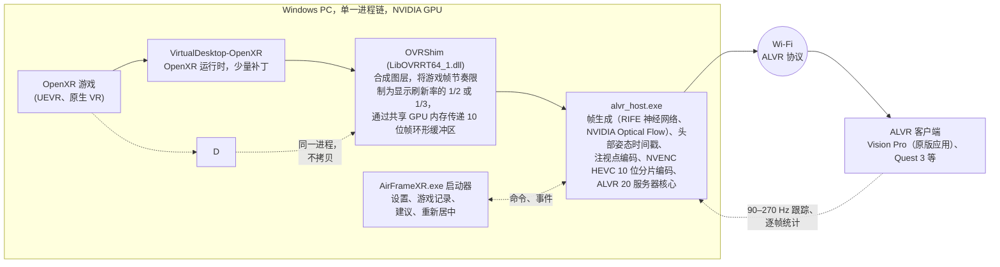

## 界面展示

下图为项目自带 UI 测试工具使用演示数据渲染的窗口，分辨率为 1080p、缩放比例为 125%（游戏历史和头显数据均为虚构，不含真实用户数据）。
运行 `python3 harness/readme_screens.py` 可重新生成这些截图。

**统一入口**。双击 `AirFrameXR.exe`：每个工具都有独立卡片（串流器、游戏统计、设置、高级视频与性能设置、诊断和头显设置）；底部还有两个小型开关：**OpenXR 运行时**（切换到 AirFrameXR 或恢复原来的运行时）和 **OpenComposite (OpenVR) 转译**（让 OpenVR 游戏运行在 AirFrameXR 上，或切回 SteamVR）。需要处理时，界面会提示 OpenXR 图层和防火墙规则的问题。游戏所使用的视野（厂商默认视野，或来自某个配置文件及其校准结果的限制视野）位于高级设置顶部：设置一次即可。

<p align="center">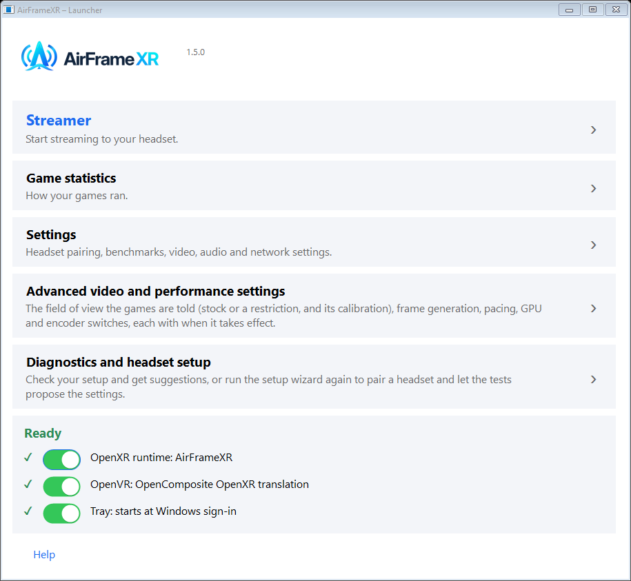</p>

**串流器**。三个实时信息块显示游戏 FPS、头显显示状态和延迟；下方一行显示串流 FPS、码率和丢包数；接着是 **功能**：帧生成（x2、x3 或自动）和可选桌面镜像的并排开关，以及伽马、锐化、眼睛高度和重新居中按钮。标题栏中的菜单（三条横线）可打开主菜单、游戏统计和高级设置。

<p align="center">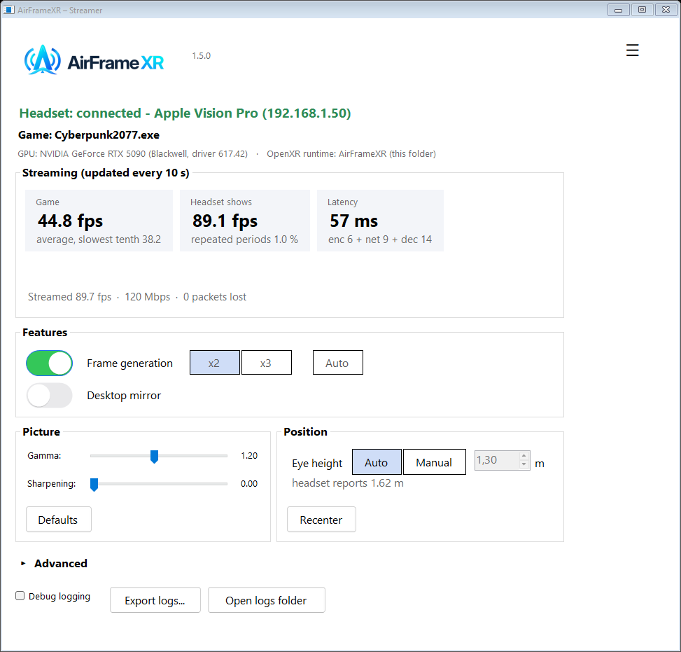</p>

**每款游戏的运行情况**。每款游戏各有一条记录。最近一次会话按从游戏（左）到头显（右）的顺序展示：FPS、帧生成、编码、网络和解码耗时、头显显示状态，以及拆分后的各部分延迟。还包括最近会话的趋势图（FPS、延迟、重复帧）、根据通用日志绘制的最近一次运行时间线（FPS、GPU 显存、帧到达提前量）、会话历史和日志导出。

<p align="center">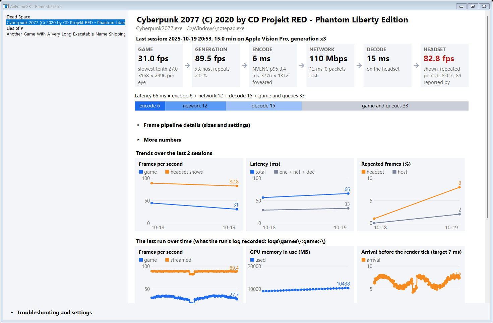</p>

**诊断并给出建议**。向导会根据当前设置执行检查，并列出取自 [docs/PERFORMANCE_KNOBS.md](docs/PERFORMANCE_KNOBS.md) 的建议：每条建议都会说明测量内容（本次运行的测试，或日志和游戏记录）以及相关设置项。除非按下按钮，否则不会应用任何更改。

<p align="center">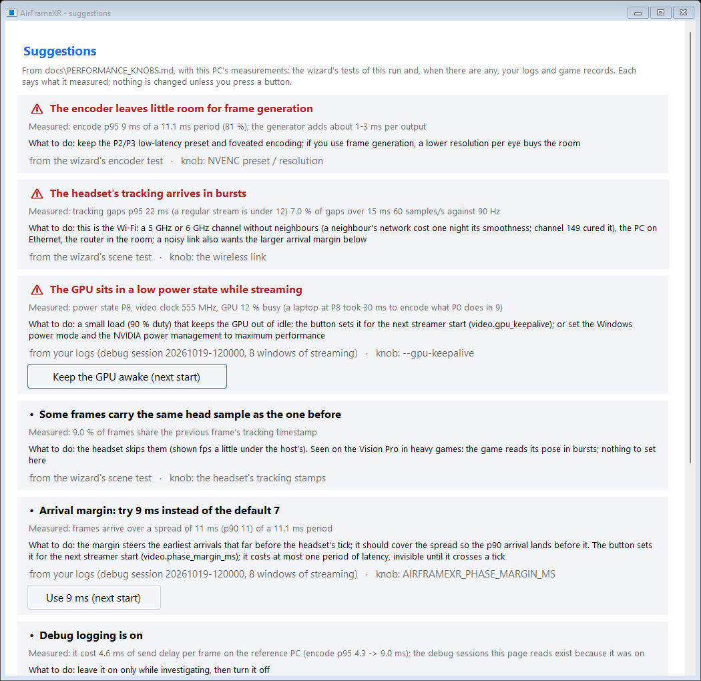</p>

**一次完成设置**。向导会读取头显支持的能力，提供社区配置文件、预填的手动配置或现有 ALVR 设置，然后测试配置结果。

<p align="center">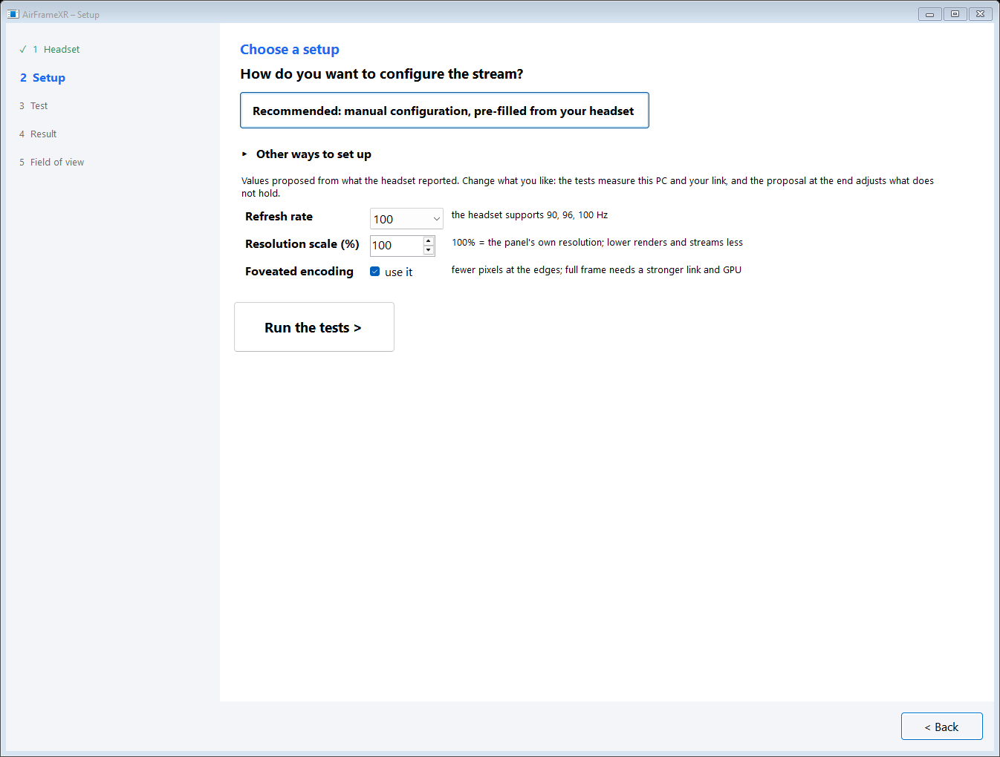</p>

**你的视野，你的配置文件**。点击高级设置顶部“视野”区域中的 *管理配置文件并校准...*，即可打开配置文件管理器。保留的每次校准和手动输入的数值都会单独保存在 `config\user_fov_profiles.json` 中，不会与设置混在一起，因此升级后也不会丢失。选择配置文件可查看示意图（虚线表示头显原生视野边界，实线表示测量窗口和视线）；可以删除不理想的配置（很多人第一次校准时都不太准确）、手动输入数值（视野角度不可能时显示红色，数值虽可能但看起来异常时显示黄色）、导入他人分享的文件，或在头显中使用 `fovgrid` 检查。Vision Pro 的标准校准配置，以及适用于 Quest 3 的起始配置（根据一项公开测量估算，游戏像素约减少 10%，本项目未验证），会复制到对应头显的配置文件中。

<p align="center">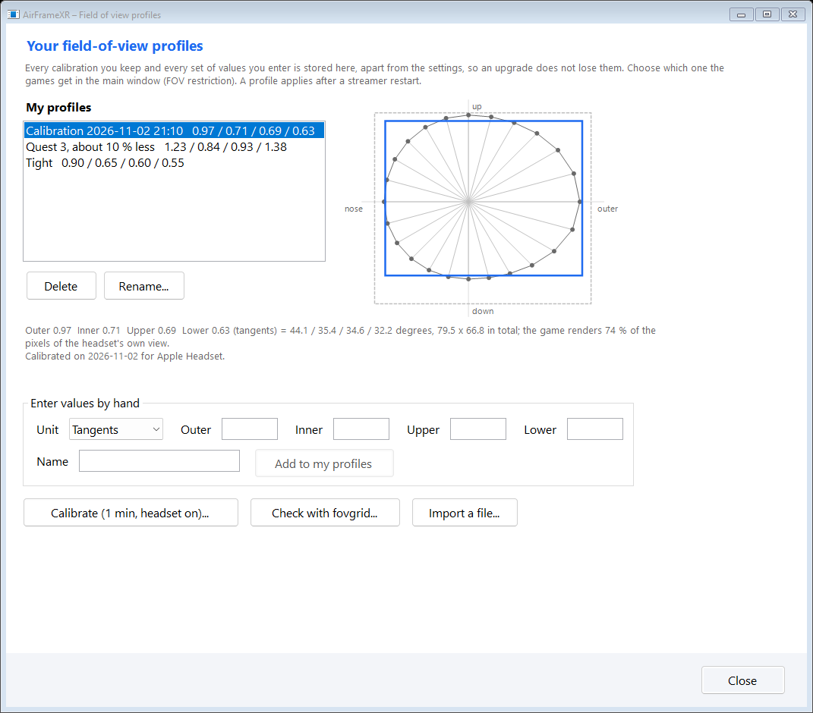</p>

**校准你自己的视野**。进入 *管理配置文件并校准...* > *校准（1 分钟，需佩戴头显）*，即可在头显中启动校准场景：每次显示一只眼睛的四条亮线来标示画面边缘（请闭上另一只眼睛）。按空格键开始。注视一条线并用方向键向外移动，直到镜片边缘切断它、使它消失；然后再往回移动，直到它重新清晰可见（Shift + 方向键可向回移动）。按 **Enter** 完成当前眼睛的校准；第二只眼睛完成后再按 Enter 即可保存。Vision Pro 的线条从 AVP 优化视野开始，其他头显则从其声明视野的 85% 开始，且不会超出头显声明的范围。校准期间需让校准窗口位于前台，并使用 PC 键盘输入按键（工具会停止桌面镜像并获得焦点，因此不会移动 Windows 鼠标）。由于引擎会向游戏告知左右眼共用的一个视野框，最终配置会为每个边缘保留两只眼睛测量值中的较大值。所有头显都使用同一工具。原有 1.3 射线向导（需 30 分钟）已从界面移除；其数学原理仍见 [docs/FOV_CALIBRATION.md](docs/FOV_CALIBRATION.md)。

*上图使用 UI 测试工具生成的虚构演示数据（配置文件和视野窗口均为编造，不是任何人的实测数据）。*

**设置向导中的视野选项**。最后一步会用同样的两个选项询问视野：默认使用 *厂商默认视野*；此处所选视野之后就会生效（可以选择 *AVP 优化视野*、自己的配置文件或手动输入的数值）。透视选项会更早出现，Vision Pro 和 Quest 的默认值均为“是”。

**防火墙规则**。检查是否存在与当前文件夹中 `alvr_host.exe` 完全对应的规则；仅在缺少规则时才提供添加选项，并列出 Windows 保留的过期、重复或阻止连接的规则，可一键移除。

<p align="center">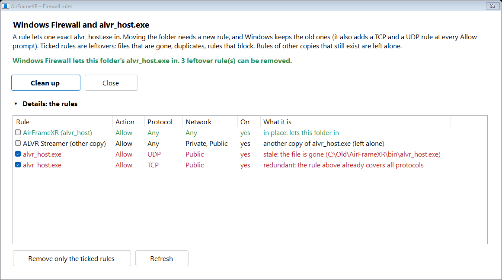</p>

<!-- AirFrameXR desktop mirror illustration -->
**桌面镜像（可选）**。两局游戏之间，可以让 Windows 桌面悬浮在头显前方，并用控制器充当鼠标：橙色光束用于指向，扳机用于单击，A / X / B / Y 用于双击，摇杆用于滚动，握把可将屏幕重新放到你面前；悬浮在屏幕下方的“? 控制”标记悬停时会显示这些操作。无需摘下头显或看向显示器，就能在当前位置启动下一款游戏。默认由右手控制器发射光束；**左手操作时**按下左扳机，光束就会切换到左手控制器（按下右扳机可切回）。这是串流器中的一个开关，也是空闲视图中替代色键透视的另一种选择。只有确认控制器正在使用时，光束和鼠标才会跟随它（例如收到该控制器的输入，或瞄准方向偏离头部）；没有 VR 控制器时，不会从头部发出光线。

<p align="center"></p>

*此图为根据真实桌面截图生成的插画，并非头显截图；实际屏幕为平面，会悬浮在房间画面或空闲纯色画面上。*头显接收的画面还会在 GPU 上针对 SDR 和 HDR 下的 7 种桌面形状进行测试（参见下文的测试平台）。

<!-- End desktop mirror illustration -->

<a id="black-box-the-performance-suite"></a>
## Black Box：性能记录与分析套件


游戏卡顿时，首先要问的是*时间花在了哪里*：游戏、编码器、网络，还是 GPU？**Black Box** 可以回答这个问题，而且不会改变日常串流方式。
它是一套**性能飞行记录器**和分析工具，作为单独安装的程序随下载包提供（位于 `blackbox\` 文件夹中，从根目录运行 `blackbox_perf.exe`）。大多数帧延迟来自游戏本身（DLSS 画质、光线追踪、分辨率），因此当串流等待游戏且 GPU 繁忙时，报告会明确指出这一点。

**Black Box Recorder**（`blackbox_recorder.exe`）是带有录制面板的串流器窗口。启动时，它会复制普通串流器的设置和头显配对信息（单向复制：绝不写入普通安装文件夹），然后按以下方式录制：

- 按键录制，默认使用 **F8**（可配置；游戏不会收到该按键）；或
- 录制**完整会话**（勾选一次即可）：从游戏启动录到游戏关闭，适用于问题要到一小时后才出现的游戏。

录制期间，程序会采样 GPU（利用率、频率、功耗、温度、显存、功耗限制状态、编码器）、Windows 计数器（CPU、内存、网络、游戏和串流器所用的 GPU 引擎），并将串流器逐帧文件保存在 `logs\performance\<time>_<scene>\` 中。**OpenXR 运行时**。Windows 同一时间只有一个活动的 OpenXR 运行时，游戏启动时会加载它，因此录制游戏时，Black Box 必须作为该运行时（即启用遥测的构建版本）。录制器启动时会说明这一点并提供切换选项；它会记住先前活动的运行时，窗口中以及关闭窗口时都会提供 **恢复原运行时...** 按钮，以还原到先前的确切运行时。由于这是系统范围的设置，每次切换都会请求 Windows 管理员权限。可选的 <strong>深度跟踪（管理员）</strong>按钮会调用 Windows 自带记录器，记录 20 秒的 GPU 和 CPU 调度情况（还会额外请求一次权限；拒绝不会更改任何内容）。

<p align="center">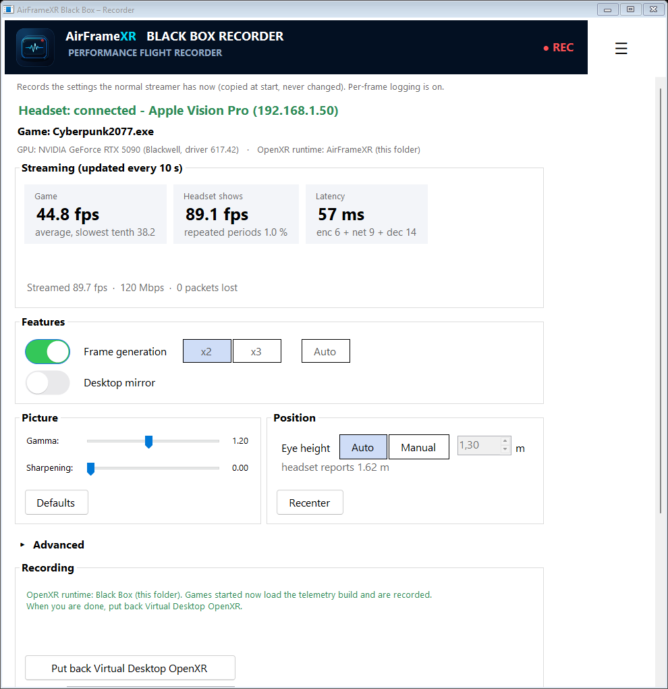</p>

**Black Box Analyzer**（`blackbox_analyzer.exe`）是之后单独运行的分析程序。只有点击后才会开始分析。它会给出一个**判定**，指出可能出问题的资源，然后按排查瓶颈的顺序列出**各资源结果：GPU、CPU、内存与 I/O、网络、VR 渲染**。每项指标都有**平均值**和**最差值**（负载的第 99 百分位数，或频率、可用内存的最低值）；每类资源都有状态和共用时间轴的**时间序列**，第一张图上方会标出延迟帧。每条曲线都以各自上限的百分比绘制（帧周期、100% 负载、所有 CPU 核心、全部内存、显示刷新率），所以 GPU 负载和以毫秒计的网络延迟可以放在同一尺度比较；将鼠标悬停在图表上，可读取对应时刻的实际数值。它还会显示长会话中最差的 10 秒时间段和最差的延迟帧；可以回放旧录制、将录制导出为 zip、删除旧录制，以及打开另一台电脑上的录制文件。录制仍在进行时，分析器会拒绝开始分析，避免与游戏争用 CPU。

<p align="center">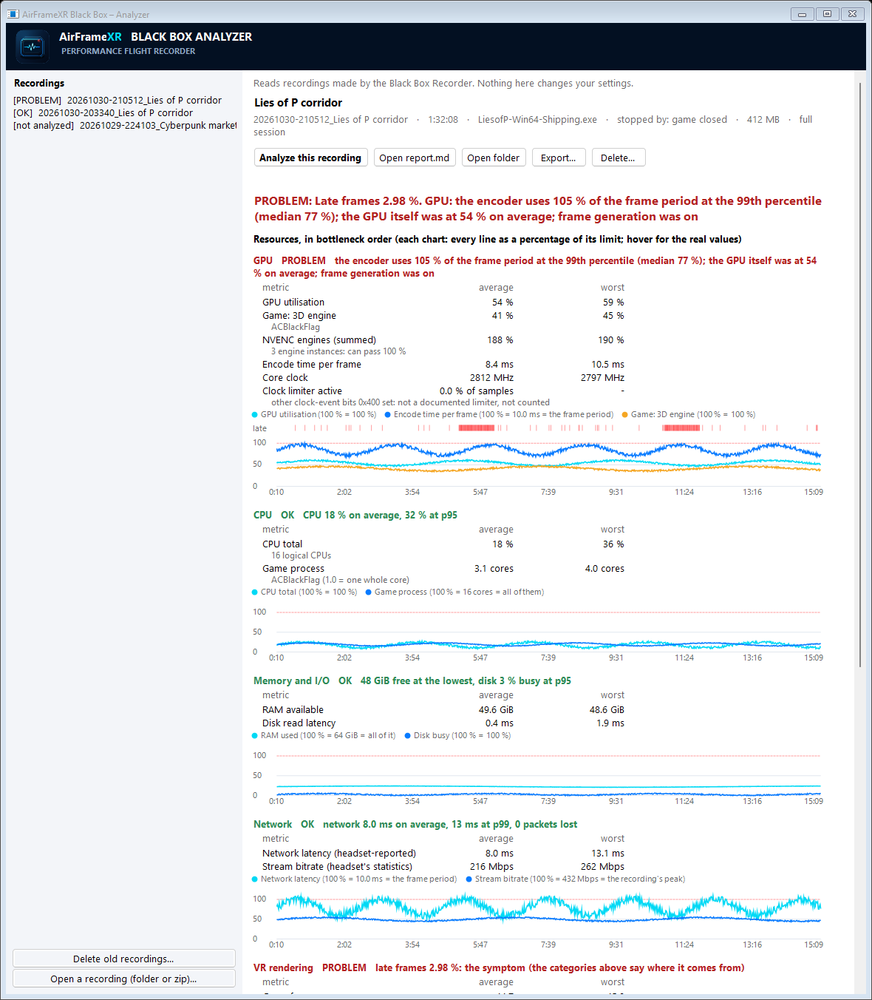</p>

*以上窗口由项目的 UI 测试工具使用虚构演示数据渲染，并非真实录制内容。*

**使用方法**。关闭普通串流器（一个头显对应一个端口），从文件夹根目录运行 `blackbox_perf.exe` 并打开 Black Box Recorder；录制器会请求切换为录制专用的 OpenXR 运行时（见下文）。连接头显并启动游戏，按 F8（或先勾选*完整会话*），游玩会卡顿的场景，再按一次 F8；然后打开 Analyzer 并点击 *分析*。若要测试其他串流器设置，请先在普通串流器中修改，再回来录制。

**为何单独分发**。逐帧日志会占用 CPU，因此普通串流器的构建版本不包含这项功能：它不会写入逐帧记录，也不会请求管理员权限。Black Box 使用同一套代码，只是在构建时启用了遥测，因此诊断不会改变日常串流的测量结果（[构建方式](docs/ARCHITECTURE.md#telemetry-and-the-black-box)）。

**已完成的测试**。在实验室设备（RTX 3080 Ti 笔记本）上，已针对已知存在和不存在故障的生成会话测试探针和报告、录制器文件处理，以及 100–200% 缩放下的 1080p、1440p 和 4K 窗口。与帧节奏实验室相比，探针自身在 1 Hz 下不可见，在 5 Hz 下使第 95 百分位数增加 0.25 ms。**尚未测试：真实头显会话中的录制**（在真实游戏中使用 F8、完整会话和深度跟踪）。请将最初的判定视为初步结果，并告诉我们你的观察。设计、测量和测试矩阵见 [docs/TELEMETRY_PLAN.md](docs/TELEMETRY_PLAN.md)、[docs/BENCH_UI.md](docs/BENCH_UI.md)。

## 功能
- **设置向导**（`configure.exe`）：读取头显支持的能力，提供社区配置文件、预填的手动配置或现有 ALVR 设置，然后测试系统与 NVENC、编码速度、配置码率下的网络，以及真实场景串流（使用头显自身的头部姿态，先测试原始画面，再以 x2 帧生成运行 30 秒）和音频。如果神经网络合成无法在这台电脑上维持头显刷新率，向导会自动改用 edge。串流器窗口中的 **查找头显...** 会搜索网络并配对；任何支持 NVENC API 12.2+ 的 NVIDIA GPU 均可使用。
- **帧节奏控制**：使用输入门控和深度为三的有序队列。Vision Pro 配置文件默认使用 300 Mbps 注视点编码。
- **逐眼使用各自的姿态**（1.5.0）。OpenXR 为一帧中的每只眼睛提供独立姿态，串流器现在会遵循这些姿态：逐眼交替渲染的模组（例如 Luke Ross 模组或 NoMoreFlat）会按各自的实际渲染姿态显示每只眼睛；没有新画面的帧会保留该画面的时间戳。重复帧依据运行时自身记录识别（参见我们的 [VDXR 分支](docs/UPSTREAM.md)），而非根据头部姿态猜测，也不会丢弃帧。高级设置中的*最高 OpenXR 兼容模式*默认关闭；游戏若重复提交每张画面两次或三次，开启后即可按完整帧率运行。原理见 [docs/ARCHITECTURE.md](docs/ARCHITECTURE.md#frames-repeats-and-the-pose-each-eye-is-shown-at-150)，设计和测量见 [docs/PLAN_UNIVERSAL_OPENXR.md](docs/PLAN_UNIVERSAL_OPENXR.md)。
- **NVIDIA Smooth Motion 警告**（1.5.0）。如果为 VR 游戏开启了 NVIDIA 平面游戏帧生成（NVIDIA App > Graphics > *Smooth Motion*），VR 模组可能出现卡顿和单眼延迟。游戏结束后，若检测到该功能正在运行，串流器会以红色提示并说明如何关闭。
- **帧生成**（默认关闭，可在串流器和设置中切换，仍属实验性质）：适用于无法维持显示刷新率的游戏。倍率为 **x2**（默认，游戏以显示刷新率的一半运行）或 **x3**（三分之一），串流器会在网络最适合发送的固定时刻生成中间帧（[为何只有这两种倍率](docs/FRAME_GENERATION.md#rates-150-x2-and-x3)）。**自 1.4.2 起，中间帧由神经网络生成：**[RIFE](https://github.com/hzwer/Practical-RIFE) 4.4 由自研 CUDA 引擎运行（`bin\neural`：CUTLASS 卷积和少量自研内核，针对该网络硬编码；由一个脚本从固定版本源码构建），逐对分析游戏帧之间画面各部分的运动和混合方式，处理分辨率为单眼分辨率的一半；之后串流器以完整分辨率绘制画面，保持静止内容精确，并让每张生成帧带有对应时刻的运动信息。它需要 RTX 30 系列或更新型号及足够的 GPU 资源；Vision Pro 串流分辨率可能令中端 GPU 无法维持帧率，因此设置向导会进行实测，并在不达标时选择 edge（见 [1.5.0 说明](docs/releases/v1.5.0.md)）。高级视频与性能设置中的 *生成帧合成* 可选择 **neural** 或 **edge**；较旧 GPU 会自动单独使用 edge。edge 使用 GPU 光流引擎（NVIDIA Optical Flow，Turing 或更新架构）估算场景内运动，再进行边缘感知合成（保持运动边缘清晰；运动不确定时显示真实帧，而不是叠加重影；思路源自 [VectorXR](https://github.com/DienerTech/vectorxr)，已重新实现）。头部转动会在两种算法估算运动前消除，摇杆转向也会测量并消除；每个输出帧都会旋转至最新的跟踪采样位置。在 RTX 5090 上搭配 Vision Pro 以 100 Hz 测试：半帧率运行时，错过的显示周期从 38% 降至 1%；也在 Quest 3 上运行过。该算法必然增加延迟（插值需要一个游戏帧周期），而且按设计不会自动开启：如果游戏能稳定维持 70–75 FPS，通常最好不要启用。勾选 **推荐**后，会根据该游戏在已连接头显上的记录运行结果设置帧率；**重新居中**（按钮和快捷键，默认为 **End**；每次游戏启动时也会发送）可将跟踪空间转向你当前面对的方向。详见 [docs/FRAME_GENERATION.md](docs/FRAME_GENERATION.md)、[docs/NEURAL_RIFE_CUDA.md](docs/NEURAL_RIFE_CUDA.md)（神经网络引擎的构建和检查方式及测量结果），以及 [docs/PERMANENT_RECORD.md](docs/PERMANENT_RECORD.md)（历史档案）中关于尝试并移除 DLSS 运动向量的说明；已移除的 x1.5 和不封顶模式见 [docs/permanent_record/FRAME_GENERATION_UNCAPPED.md](docs/permanent_record/FRAME_GENERATION_UNCAPPED.md)。
- **从串流器为游戏设置视野**：显示相对于游戏原本渲染内容节省的资源、可用于提升画质的百分比、在头显中进行的一分钟校准（每只眼睛四条线）；Vision Pro 还会根据 Apple 速率图和你的选择计算注视点区域。[工作原理](#how-fov-restriction-works)。
- **各类窗口**（见上文）：启动器、串流器、日志与性能、带建议的诊断、设置向导、视野校准、防火墙检查和 OpenXR 图层检查。它们会适配显示器（从 1080p 笔记本到 4K，缩放 100–200%），并由下文的 UI 测试工具检查。
- **桌面镜像**（可选）：见上文；左右手均可使用。
- **高级视频与性能设置**：适用于希望自行测量的用户，可调整游戏渲染画面和时序的开关。每个设置都会说明生效时机和测量依据；恢复默认值后，该选项会从设置文件中移除。HEVC QP 映射默认开启，旁边会说明其取舍。
- **Black Box**（下载包内单独分发）：针对单款游戏的性能飞行记录器和分析工具，[见上文](#black-box-the-performance-suite)。
- **实验室工具**：包括下文介绍的测试平台、帧生成评判工具（[docs/FRAME_GENERATION_JUDGE.md](docs/FRAME_GENERATION_JUDGE.md)）和 QP 映射 A/B 测试。

各版本的变化见 [docs/releases/](docs/releases/)（从 1.0 版开始；更早的说明见 GitHub 发布页面和历史档案）。[docs/progress.md](docs/progress.md)记录当前状态：已构建、已测试（及测试方式）和未测试的内容。更早的历史记录见 [docs/PERMANENT_RECORD.md](docs/PERMANENT_RECORD.md)。

## 状态
- **已在真实头显上运行**（在 RTX 5090 + Vision Pro，以及搭配 Meta 商店版 ALVR 客户端的 Quest 3 上测试）：绝大多数 UEVR 游戏、Luke Ross 模组（《Dead Space Remake》）、原生 VR 游戏、控制器（ALVR 的 Quest/Touch 模拟）、触觉反馈、游戏音频，以及使用原版应用进行发现和配对。
- **已知问题：**
  - 部分 OpenXR 游戏需要使用 SteamVR + ALVR 后备方案。OpenVR 游戏不受原生支持：内置 OpenComposite 转译在我们尝试过的旧 OpenVR 游戏中约有 60% 可用（见上文），其余仍需要 SteamVR。
  - 不支持 USB 串流；通过 ALVR 自带工具桥接时除外。
  - 为最大化分片编码性能，HEVC 编码路径已固定；不支持 H.264 或 AV1。
  - 诊断工具仍处于实验阶段，例如网络带宽评估目前仍标记为不可靠。
- **不同配置下的主观画质差异可能很大，尤其是在开启帧生成时**。同一版本在相同电脑和头显上有时会有不同表现，原因来自环境条件而非游戏：Wi-Fi 信道（邻近网络曾造成微卡顿，原版 ALVR 也出现同样问题；改用信道 149 后解决）、面板运行于 100 Hz 而非 90 Hz、帧需要在头显刷新时刻前提前到达的时间（默认 7 ms）、每款游戏的生成速率，以及 Quest 以 270 Hz 进行跟踪却被识别为 241 Hz 显示器。这些因素均有测量，大部分也已处理，但更换电脑、路由器或头显后仍可能出现新的问题。如果体验不佳，日志通常能说明原因；每个设置项的作用及其调节依据见 [docs/PERFORMANCE_KNOBS.md](docs/PERFORMANCE_KNOBS.md)，相关实测经验见 [docs/PERFORMANCE_FINDINGS.md](docs/PERFORMANCE_FINDINGS.md)。
- 为电脑、路由器和头显选择设置的基准测试目前完成了一半：无头画质扫描已可运行（[docs/BENCHMARK_DESIGN.md](docs/BENCHMARK_DESIGN.md)）；头显测试阶段和自动应用结果的功能仍待实现。已在单 NVENC 笔记本 GPU 和 RTX 5090 上测量。

<a id="how-fov-restriction-works"></a>
## 视野限制的工作原理

**什么是视野**。头显画面是观察现实世界的一扇窗口；OpenXR 用从眼睛视线轴到窗口边缘的四个角度描述它：左、右、上、下（`XrFovf`）。渲染器使用这些角度的正切值，因为平面投影与正切值成线性关系：图像在水平方向覆盖 `tan(left) + tan(right)`，在垂直方向覆盖 `tan(up) + tan(down)`；像素密度可表示为“单位正切值对应的像素数”。四个角度通常并不相等：鼻侧视野小于外侧视野。Vision Pro 应用声明的视野如下（左眼，右眼与其镜像对称；外侧指远离鼻梁的一侧）：

| 边缘 | 外侧 | 内侧 | 上侧 | 下侧 |
|---|---|---|---|---|
| 声明角度 | 60.8 度 | 45.6 度 | 50.6 度 | 45.6 度 |
| 声明正切值 | 1.79 | 1.02 | 1.22 | 1.02 |

这对应 106 × 96 度视野，推荐每眼图像分辨率为 3552 × 3200。Quest 3 声明 94 × 99 度，并能显示全部内容；Vision Pro 则不然：根据网格测量（[docs/AVP_FOV.md](docs/AVP_FOV.md)，一人、左眼、初步估算），它实际显示约 80 × 74 度，而声明视野为 106 × 96 度（正切值为 1.69 × 1.49，而不是 2.81 × 2.24），因此帧中约一半像素落在可视范围之外。

**游戏如何使用视野**（我们查阅了 UEVR 的 OpenXR 路径）。OpenXR 游戏启动时会向运行时查询两项信息。`xrEnumerateViewConfigurationViews` 返回每只眼睛的推荐图像尺寸；`xrLocateViews` 返回每只眼睛的姿态和四个视野角度。UEVR 根据这些角度构建投影矩阵，按推荐尺寸（再乘以游戏自己的分辨率滑块值）创建交换链、进行渲染，并提交携带相同角度和尺寸的投影图层。它不使用可见性遮罩，握手过程也不会通知后续变更，因此游戏启动时只读取一次这些值。运行时也只读取一次（VDXR 会在系统创建时锁存这些值）。这就提供了可调节的空间：**游戏会渲染告知它的视野范围**。告知游戏较小的视野，并按比例缩小图像尺寸，受 GPU 限制的游戏就能减少工作量。

**AirFrameXR 如何使用视野**。头显的真实视野是客户端必须遵守的约定：Vision Pro 应用会将串流帧映射到它所声明的视野范围，因此帧必须继续覆盖整个范围；只有告知游戏的视野会改变。Vision Pro 上的帧处理流程如下：


1. **头显连接时声明视野**。应用会发送渲染视锥（`views_config`）。主机将其保存到 `config\airframexr_views.json`；启动器中的视野卡片会据此仅提供适用的配置文件。
2. **选择告知游戏的视野**。在启动器的视野卡片中选择 *视野限制* 和一个配置文件（四个正切值：外侧、内侧、上侧、下侧）。该配置文件的副本会写入 `airframexr.json`；其数值绝不会超过头显声明的范围。Vision Pro 的可视窗口及适用的校准数值见 [docs/AVP_FOV.md](docs/AVP_FOV.md)（0.97 / 0.71 / 0.69 / 0.63，这是复制到配置文件中的标准校准值）。主机将其转换为头显各边缘正切值的比例，并发布给 shim。
3. **Shim 在下次启动游戏时响应查询**。`GetEyeFov` 返回限制后的视野角度；推荐图像尺寸则根据串流眼睛尺寸和各轴受限后的视野范围比例进行缩放（使用上表数据并由 AirFrameXR 客户端声明其自身可视范围时，约为 2800 × 2500，像素约占 68%；这是计算值，并非实测值）。游戏会使用该尺寸和受限投影进行渲染。
4. **合成时将画面放回正确位置**。Shim 会将游戏图层映射至覆盖头显完整视野的帧中（每眼 3552 × 3200），游戏未渲染的边缘区域保持黑色，并根据相应角度放置图像。
5. **注视点变形、编码、网络传输和解码不受影响**。双眼画面仍会经过 ALVR 注视点变形，合成为一张 4224 × 1664 帧，再像以前一样通过 NVENC 编码。黑边位于视野边缘，而变形对边缘压缩最明显，因此黑边占合成帧的 51%，占串流帧的 34%；黑色区块几乎不消耗码率。
6. **客户端执行反变形**。客户端仍会像往常一样将帧映射到头显声明的视野范围。边缘处会出现黑边，但对于上述数值，它位于镜片本来就看不到的位置。

因此，节省的只有游戏端 GPU 工作量；编码时间、码率、解码时间、帧生成和头显应用均不变。游戏若不受 GPU 限制，则不会因此获益。这些数值**需要重启串流器**（启动器的视野卡片在更改设置时会替你关闭串流器；修改完成后需重新启动。运行中的游戏仍使用启动时的画面，因此取消限制后要到下次启动才会看到变化）。视野覆盖设置还会记住其对应的头显：连接视野不同的头显（例如从 Vision Pro 换成 Quest）时，不会应用该设置，窗口也会说明原因（Quest 的下视野边缘为 55 度，若下侧正切值低于 1.00 就会被裁切）；再次勾选时会根据新头显自身的视野重新计算。

**将节省的资源用于画质：“将节省的资源用于画质”（1.3.5）**。面板会显示视野限制节省的资源：*不限制时，游戏每眼渲染 3552 × 3200（11.4 Mpx）；限制后为 1628 × 1264（2.1 Mpx），节省 82%*（具体数值取决于你在设置中声明的分辨率，或头显配置文件的分辨率；Vision Pro 为 3552 × 3200，并与告知游戏的视野框进行比较）。未勾选时，游戏渲染尺寸会尽量匹配串流自身的像素密度；勾选后，你可以设置相对于声明分辨率下同一视野框像素数的百分比：**100% 表示逐像素匹配该分辨率**（约 2126 × 1886，4.0 Mpx，仍可节省 65%）；最低值为串流密度；再勾选一次“允许超过 100%”后可进行超采样，最高达到串流自身尺寸（275 Mbps 时为 2720 × 2144，146%）：边缘更清晰、GPU 耗时更长，但不会产生串流无法承载的细节（275 Mbps 时每单位正切值约一千像素）。该百分比会在确认一次后提交（按 Enter、离开输入框或停止输入片刻），而不是像滑块一样每次移动都写入设置。每当串流尺寸或视野框改变时，该百分比都会转换为引擎的画质值（在下限和上限尺寸之间混合）；引擎以线性方式混合两种尺寸，因此在像素数相同时，实际尺寸的形状与逐像素匹配的结果会略有不同。你在设置中输入的尺寸会保留（串流尺寸不再随码率变化，但注视点区域仍会据此计算；点击 *自动* 可恢复由码率决定的尺寸），并作为你声明的分辨率。数值框或滑块只有在点击进入后才会响应鼠标滚轮；否则滚轮用于滚动页面。

**注视点区域会随你的选择变化（Vision Pro，1.3.5）**。ALVR 注视点编码会保留画面中的一条高密度区域，并压缩其余部分。Apple 的合成器已经会丢弃显示边缘的细节（光栅化映射图；目前测量的两台头显使用的映射图静态且相同）。启动器会根据这张映射图和你的选择计算高密度区域及压缩比例，并写入 `session.json`：每次启动串流器、保存设置，以及每次选择视野限制时都会写入。未限制视野时，高密度区域随 Apple 映射图变化；启用限制后，它会以你的视野窗口为中心（并额外扩展两度），因为游戏不会绘制窗口之外的内容。**压缩强度始终弱于 ALVR 自身的默认值**（中心区域至少比 0.45 × 0.40 大 10%，边缘比例至少比 4 / 5 小 20%），并且只增加 Apple 映射图现有压缩量的约 60%，因此边缘仍保持清晰（第一个版本的压缩量与 Apple 完全相同，在头显中看起来过度压缩）。串流尺寸随恒定码率变化（配置文件中的每像素 0.474 bit），且不会超过 Apple 原生像素密度或 NVENC 宽度上限；你在设置中输入的尺寸或注视点数值在下次选择前不会被改动。Quest 会继续使用配置文件中的数值，因为 Meta 没有对应映射图。

**自行校准**。启动器 > 视野卡片 > *管理配置文件并校准...* > *校准（1 分钟，需佩戴头显）*：参见上文的“校准你自己的视野”。配置文件格式见 [docs/HMD_PROFILES.md](docs/HMD_PROFILES.md)。此功能在 1.3.5 中新增，已在 PC 和实验室环境检查，尚未在头显上测试。

**目前尚不确定的事项**。可视窗口是一个人在一次头显佩戴状态下测得的左眼数据；它会随遮光垫、眼镜镜片和瞳距变化，因此建议从推荐行（可视窗口外扩 3 度）开始，并用 `fovgrid.exe` 检查边角是否有黑边（[docs/FOV_GRID.md](docs/FOV_GRID.md)）。Vision Pro 配置文件包含实测窗口和建议渲染画质（25%）；它们只会为匹配的头显复制到配置文件中，不会自动应用（[docs/HMD_PROFILES.md](docs/HMD_PROFILES.md)）。实验室场景已覆盖该功能（应用收到的正切值和推荐尺寸完全符合预期、边缘保持黑色、画面位于视野窗口内），但尚未在真实游戏中测试。更大的优化空间是只将串流自身的像素用于可视窗口；这需要客户端声明该窗口，单靠主机无法实现。详情和设置项参见 [docs/EXPERIMENTAL_SWITCHES.md](docs/EXPERIMENTAL_SWITCHES.md)。

## 游戏音频
无需安装额外软件，游戏声音即可传到头显：主机使用 **Windows 进程环回**捕获游戏音频（在 Windows 输出音量和静音之前获取 PC 播放的所有声音），因此不会更改 Windows 默认输出，管理员权限启动的游戏也能录到声音。串流器运行期间可将 PC 扬声器静音（设置中的复选框，默认开启），关闭时会恢复原静音状态。虚拟音频线缆（VB-CABLE，独立产品）是后备方案，也是将头显**麦克风**输入游戏的唯一方式。详情及尚未测试的内容见 [docs/INSTALL.md](docs/INSTALL.md#game-audio-and-headset-microphone)。

## 系统要求
- Windows 10/11、带有当前驱动的 **NVIDIA** GPU（NVENC API 12.2+）；推荐 RTX 40 系列或更新型号（部分 GPU 配备多个 NVENC 单元，可启用分片编码）。神经网络帧生成需要 RTX 30 系列或更新型号（旧款 GPU 使用光流合成）。
- **Apple Vision Pro** 或 **Meta Quest 3**，搭配 AirFrameXR 客户端或原版 **ALVR** 应用（20.14.x，见上文）；电脑和头显需在同一局域网中（第一代 Vision Pro 使用 5 GHz Wi-Fi 6；较新型号和 Quest 3 可使用 6 GHz）。目前仅面向这两款头显。
- **有线连接**：Meta Quest 可通过 USB 连接并启用 **USB 网络共享**（头显随后会作为网络接口出现在 PC 上），也可使用 [ADBForwarder](https://github.com/alvr-org/ADBForwarder)（ALVR 的轻量 adb 辅助工具；运行它、打开 Quest 上的 ALVR 应用，并将 `127.0.0.1` 作为头显地址：未发现设备时，向导会显示 *Quest 通过 USB 线连接？* 链接）。AirFrameXR 本身不运行 adb。Vision Pro Developer Strap 也可作为网络连接使用。
- 串流期间请关闭 SteamVR 和 ALVR 自带的启动器（它们会使用相同端口）。

## 推荐的网络设置
串流视频需要 100+ Mbit/s 的低延迟带宽，因此网络状况比 PC 更重要。推荐配置如下：
- **为头显单独准备一台 Wi-Fi 6 或更新标准的路由器**，放在同一房间内（尽量保持视线无遮挡）。第一代 Vision Pro（M2）**只支持 5 GHz Wi-Fi 6，不支持 6 GHz**：请使用 5 GHz 频段和 **160 MHz 信道**。6E/7 路由器也可以；新型号 Vision Pro 和 Quest 3 可使用 6 GHz 频段。将它设为**纯接入点模式**（关闭路由器功能、NAT 和自带 DHCP 服务器），并通过以太网连接到主路由器或交换机，使头显与 PC 位于同一子网，避免第二层 NAT 增加延迟。
- **PC 使用以太网**（不要使用 Wi-Fi），并与接入点连接到同一网络。
- **为头显设置固定 IP**：在 DHCP 服务器（通常是主路由器）上，根据头显的 **MAC 地址**设置 DHCP 保留。在 visionOS 中，将该网络的 *专用 Wi-Fi 地址*设为“关闭”或“固定”，否则 MAC 地址可能变化，导致保留规则失效。固定地址有助于稳定配对和重连。
- 游戏期间不要让接入点承担其他大量流量（例如下载或其他头显）。

## 安装（用户）
下载发布版 zip，解压到任意位置，然后双击 `AirFrameXR.exe`（启动器，是文件夹根目录下唯一的程序）：首次将 OpenXR 运行时切换至 AirFrameXR（会弹出一次管理员权限提示；同一按钮也可切回原设置），运行**设置向导**（配对头显、执行测试并配置设置），然后打开**串流器**（游戏期间保持运行）。详细说明、设置和日志见 [docs/INSTALL.md](docs/INSTALL.md)。
头显 IP 地址无需固定：AirFrameXR 会连接保存的地址，并根据名称自动重新查找已配对的头显；窗口中的 **查找头显...** 按钮可搜索网络、配对新头显，或使用你输入的地址。
`configure.exe` 提供头显共享的**社区配置文件**（JSON 文件，支持导入/导出；参见 [docs/HMD_PROFILES.md](docs/HMD_PROFILES.md)；初始提供的 Quest 和 Pico 配置文件尚未验证）、手动配置或现有 ALVR 配置，然后在你的电脑和网络上测试结果。

## 从源码构建（贡献者）
AirFrameXR **仅支持在 Windows 上构建**（需要 MSVC、Windows SDK 和 NVENC；不支持从 Linux 交叉编译）。安装好前置依赖后（[docs/DEVELOPMENT.md](docs/DEVELOPMENT.md)：Git、Rust、CMake、LLVM、NuGet、带 C++ 工具的 Visual Studio 2022，均可通过 `winget` 安装，另需 NVIDIA 驱动），执行：
```powershell
git clone https://github.com/jfbobier/AirFrameXR.git
cd AirFrameXR
powershell -ExecutionPolicy Bypass -File build.ps1
```
首次运行会下载固定提交版本的 ALVR v20.14.1 和 VirtualDesktop-OpenXR 并构建它们（需要 10 分钟以上、约 6 GB 空间）；生成的便携文件夹和 zip 与发布包相同，位于 `out\dist\`。自动化测试平台（使用无头模拟 ALVR 客户端执行端到端场景，无需头显）见 [harness/README.md](harness/README.md)。
另请参阅 [CONTRIBUTING.md](CONTRIBUTING.md)。

## 仓库结构
主机端使用 Rust（`tools/host/`），并依赖 C++ NVENC 库（`nvenc/hostlib/`）；OpenXR 端位于 `ovrshim/`（VDXR 示例驱动的分支）；窗口使用 C# WinForms（`tools/gui/`）；测试平台使用 Python（`harness/`）。完整目录表见 [docs/DEVELOPMENT.md](docs/DEVELOPMENT.md#repository-layout)。

## 与上游项目的关系
ALVR（v20.14.1）和 VirtualDesktop-OpenXR 均不会作为长期维护的分支存在：项目会依据 `deps.lock.json` 中固定的上游提交获取它们，并应用少量带断言的补丁；如果上游发生变化，构建会明确报错，而不会悄悄偏离。ALVR 编码器源码以未修改形式 vendored，并在构建时打补丁；`ovrshim/` 是唯一真正 fork 的组件（基于 VDXR 示例驱动）。补丁内容及其规模见 [docs/UPSTREAM.md](docs/UPSTREAM.md)。

<!-- AirFrameXR developer philosophy -->
## 开发者须知：设计理念

**性能优先，复杂度最低**。AirFrameXR 有意保持目标聚焦：打造快速、轻量的 OpenXR 到头显管线，而不是通用 VR 启动器。拒绝功能臃肿，坚持一个工具只做好一件事，在合适之处使用原生工具，并且只接受有测量结果支持的改进。欢迎使用 AI 辅助贡献，但需承担相应责任（在 `docs/ai-contributions/` 中提交工作摘要）。提出更改前请阅读[开发理念](docs/DEVELOPMENT_PHILOSOPHY.md)和 [CONTRIBUTING.md](CONTRIBUTING.md)。**本项目不会变成功能臃肿的软件。**

## 开发者须知：测试平台

上文中的所有功能都是由一位开发者和一个 AI 智能体每天晚上共同迭代调优的：修改、在 PC 上构建、运行实验室测试、查看判定，然后在头显上进行一次测试。实验室让这个流程更可靠，因为头显测试只反映一个人在某个晚上、某个 Wi-Fi 环境下的主观体验；实验室则能在可控条件下运行同一条管线，并使用不会疲倦的评判工具。

实验室中的管线不是模拟品：运行的是真实主机、shim、输入门控、时钟、生成器和编码器；被替换的是游戏、头显和网络，并由行为完全已知的组件代替，因此画面中的缺陷可以归因于管线本身。

简而言之，测试组件包括：可控制帧耗时、CPU/GPU 开销和运动标记的**虚拟游戏**（实际运行的 OpenXR 应用）；会重放真实会话跟踪瑕疵的合成头部和显示头显预期画面的**虚拟头显**；对显示画面评分的**评判工具**（测量头部旋转抖动、运动标记卡顿，以及生成帧与真实渲染参考帧之间的差异，而非主机计数器）；命名场景；在真实头显上运行相同流程的**实时测试平台**；用于稳定性故障注入和长时间运行的测试；以及对窗口、桌面镜像、音频、防火墙检查和视野功能的验证。各组件所在位置及运行方法见 [harness/README.md](harness/README.md#lab-overview-what-each-piece-is)。

使用方法：先运行一次 `python3 harness/simrig/run_sim.py build`，然后执行 `run <scenario> --seconds 40`；结果保存在 `harness/results/`。[docs/DEVELOPMENT.md](docs/DEVELOPMENT.md)中提供了完整流程和构建器设置说明。**调试构建**保留实验室所需的逐帧遥测；**发布构建**会将其编译移除（公开发布使用此版本）。

**Pull Request**。凡涉及帧管线（shim、管线、生成器、编码器或帧节奏控制）的更改，只有在 PR 描述中附上实验室验证证据才会被接受：相关场景、更改前后的判定结果，以及编译检查。“在我的头显上看起来没问题”正是本项目的起点；而测试平台正是因为这种验证方式还不够可靠才建立的。通常还应针对修复的问题新增测试场景。GUI 更改需确保 `harness/ui_matrix.py` 的结果仍为 0 FAIL（参见 [harness/README.md](harness/README.md)：其中说明了该工具执行的检查）。

**可迁移性**。除了连接所用的 IPC，测试平台中的内容都不依赖 AirFrameXR。可控成本和精确向量的虚拟游戏、重放真实跟踪瑕疵的虚拟头显、模拟客户端重投影的查看器，以及衡量画面而非计数器的评判工具，都可用于优化 OpenXR 到头显链路的其他项目：另一款串流器、合成器或帧生成层。欢迎取用。

## 致谢
AirFrameXR 得以实现，离不开以下项目提供的基础和贡献：
- **[ALVR](https://github.com/alvr-org/ALVR)**（MIT），由 polygraphene 和 alvr-org 贡献者开发：本项目依赖的基础设施、串流协议、服务器核心、网络、音频、注视点编码和 NVENC 编码器代码，以及运行在头显上的 [ALVR visionOS 客户端](https://github.com/alvr-org/alvr-visionos)。
  正是 ALVR 让无线 PC VR 得以开源。
- **[VirtualDesktop-OpenXR (VDXR)](https://github.com/mbucchia/VirtualDesktop-OpenXR)**（MIT），由 Matthieu Bucchianeri 及其贡献者开发：出色且高度优化的 OpenXR 运行时，本项目中的所有游戏都运行于此；OVRShim 最初基于其 OVRNull 示例。也感谢同一作者开发了 VR 社区所依赖的许多其他 OpenXR 工具。
- **[OFXR-Bridge](https://github.com/tig3rmast3r/OFXR-Bridge)**（LGPL-3.0），由 tig3rmast3r 开发：其思路曾影响帧生成器的早期设计。本项目研究并重新实现了它的合成方案，作为第一种“经典”合成方式（已于 1.5.0 移除，edge-aware 方案表现更好）；其永不阻塞的安全规则仍用于保护帧生成器。
- **[VectorXR](https://github.com/DienerTech/vectorxr)**（MPL-2.0），由 DienerTech 开发：本项目研究了其边缘感知合成方案（向量中值、源帧求解光流、运动边缘处逐像素选择候选结果、不确定运动向真实帧收敛），并在此重新实现。
- **[RIFE](https://github.com/hzwer/Practical-RIFE)**（MIT），由 hzwer（Zhewei Huang）及其合作者开发（论文“Real-Time Intermediate Flow Estimation for Video Frame Interpolation”，ECCV 2022）：神经网络帧生成所用的网络。RIFE 4.4 权重经过转换后随程序存放于 `bin\neural`；我们的 CUDA 引擎依据 **[vs-rife](https://github.com/HolyWu/vs-rife)**（MIT，由 HolyWu 开发）的模型代码实现，其发布页面提供权重文件。感谢你们让实时插帧技术开源。
- **[OpenComposite](https://gitlab.com/znixian/OpenOVR)**（GPL-3.0-or-later），由 znixian 及其贡献者开发：OpenVR 到 OpenXR 的转译层，让旧版 OpenVR 游戏无需 SteamVR 即可运行于 AirFrameXR。项目预构建的 DLL 与源码和许可证一同原样放在 `opencomposite\` 中；它们是独立程序（没有链接进 AirFrameXR），仅当启动器的 OpenVR 开关开启时才会由游戏加载。
- NVIDIA Video Codec SDK 和 Optical Flow SDK 头文件（MIT）；编译进神经网络引擎的 NVIDIA [CUTLASS](https://github.com/NVIDIA/cutlass)（BSD-3-Clause）。cgltf（MIT）、stb_image（公有领域 / MIT）、Draco（Apache-2.0，仅用于离线转换器）。
- 基准测试场景：“Littlest Tokyo”，由 Glen Fox 创作（[glenatron](https://sketchfab.com/glenatron)），采用 CC-BY-4.0 许可；经过转换后放置于一个带纹理的房间中。背景音乐为 Roa Music 的 “Sakura Breeze”，来自 [free-stock-music.com](https://www.free-stock-music.com) 的免版税音乐，采用 CC BY 3.0 许可（[许可证](https://creativecommons.org/licenses/by/3.0/deed.en_US)），已裁剪并重新编码。

详情见 [THIRD_PARTY_NOTICES.md](THIRD_PARTY_NOTICES.md)。AirFrameXR 与 ALVR 项目、Apple、NVIDIA、Virtual Desktop、OFXR-Bridge、VectorXR、RIFE 作者或 OpenComposite 均无关联，也未获其认可。Apple Vision Pro 和 visionOS 是 Apple Inc. 的商标。

## 许可证
MIT，详见 [LICENSE](LICENSE)。第三方组件仍遵循各自的许可证（[THIRD_PARTY_NOTICES.md](THIRD_PARTY_NOTICES.md)）；作为独立文件分发的 OpenComposite 使用 GPL-3.0-or-later（`docs\licenses\OpenComposite-LICENSE.txt`）。

## 文档

- **从这里开始：**[docs/INSTALL.md](docs/INSTALL.md)（安装、设置、日志、音频）、[docs/PERFORMANCE_KNOBS.md](docs/PERFORMANCE_KNOBS.md)（每个设置项及其调节依据）、[docs/EXPERIMENTAL_SWITCHES.md](docs/EXPERIMENTAL_SWITCHES.md)（高级视频与性能设置窗口）、[docs/HMD_PROFILES.md](docs/HMD_PROFILES.md)（社区配置文件）。
- **工作原理：**[docs/ARCHITECTURE.md](docs/ARCHITECTURE.md)（帧管线、线程、缓冲区）、[docs/FRAME_GENERATION.md](docs/FRAME_GENERATION.md)、[docs/FRAME_GENERATION_JUDGE.md](docs/FRAME_GENERATION_JUDGE.md)、[docs/AVP_FOV.md](docs/AVP_FOV.md) 和 [docs/FOV_GRID.md](docs/FOV_GRID.md)（视野；[视野限制的工作原理](#how-fov-restriction-works)）、[docs/CHROMA_KEY_PROTOCOL.md](docs/CHROMA_KEY_PROTOCOL.md)、[docs/DESKTOP_MIRROR.md](docs/DESKTOP_MIRROR.md)、[docs/UI_SPEC.md](docs/UI_SPEC.md)、[docs/CONFIGURE_WIZARD.md](docs/CONFIGURE_WIZARD.md)、[docs/BENCHMARK_DESIGN.md](docs/BENCHMARK_DESIGN.md)。已移除的不封顶模式与 x1.5 说明已归档于 [docs/permanent_record/FRAME_GENERATION_UNCAPPED.md](docs/permanent_record/FRAME_GENERATION_UNCAPPED.md)。
- **经验总结：**[docs/PERFORMANCE_FINDINGS.md](docs/PERFORMANCE_FINDINGS.md)（已尝试过的方案，避免重复走弯路）。
- **参与贡献：**[CONTRIBUTING.md](CONTRIBUTING.md)、[docs/DEVELOPMENT.md](docs/DEVELOPMENT.md)、[docs/DEVELOPMENT_PHILOSOPHY.md](docs/DEVELOPMENT_PHILOSOPHY.md)、[docs/UPSTREAM.md](docs/UPSTREAM.md)、[harness/README.md](harness/README.md)。
- **状态和历史：**[docs/progress.md](docs/progress.md)、[docs/releases/](docs/releases/)。较早的计划和日志存档于 [docs/PERMANENT_RECORD.md](docs/PERMANENT_RECORD.md)（仅在需要回顾过去决策时查阅）。
